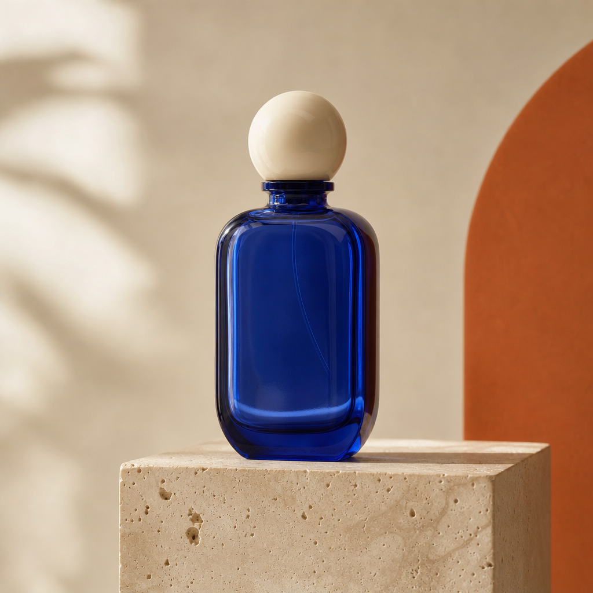
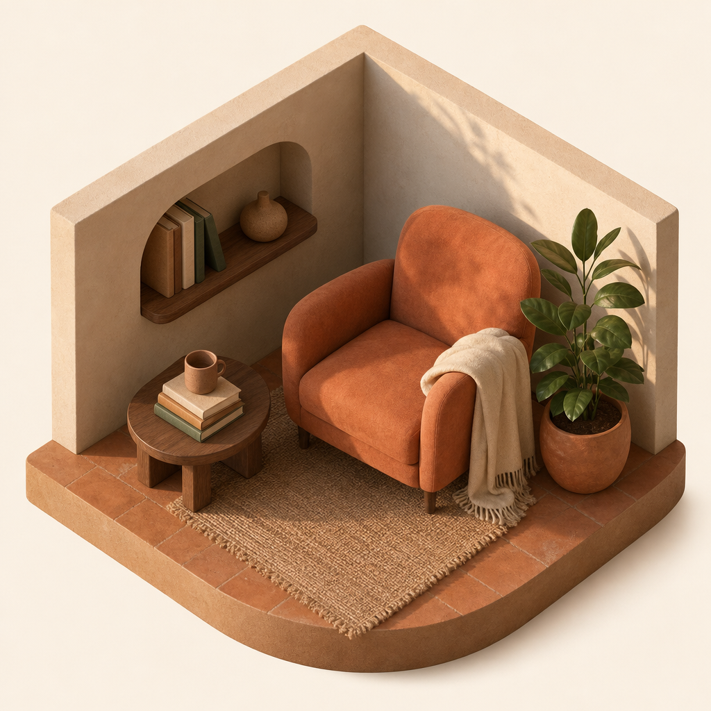
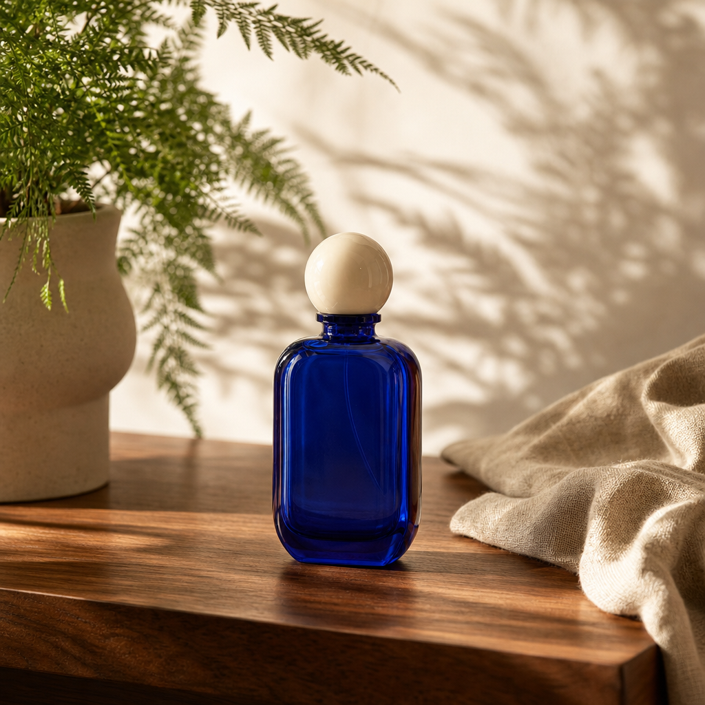
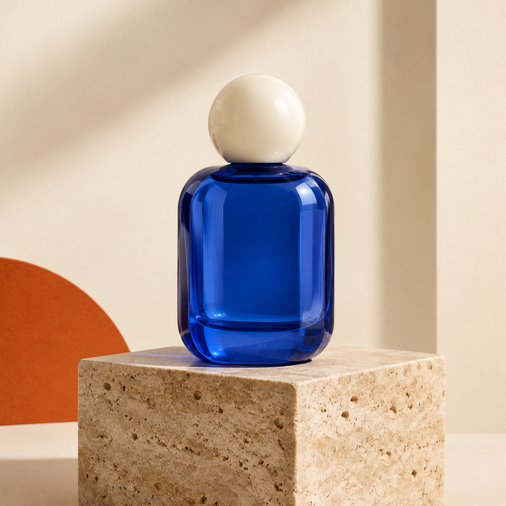

# Real CLI outputs · 2026-10-13

Original prompts are ours; no upstream gallery images or prompts are copied. Reference consistency is a prompt goal, not a guarantee.

## vip-product

1024×1024 · task `tsk_img_01M4T6238EPSVZA34GQ1AEJ7K4` · [Evidence](evidence/vip-product.json)

## vip-isometric

1024×1024 · task `tsk_img_01M4T66T1H9NA991JNXHAK1R6R` · [Evidence](evidence/vip-isometric.json)

## vip-reference-edit

1024×1024 · task `tsk_img_01M4T69CFES5J792G79Z1G493R` · [Evidence](evidence/vip-reference-edit.json)

## standard-product

1024×1024 · task `tsk_img_01M4T6B5RZ1BNRTGZA1MASASQE` · [Evidence](evidence/standard-product.json)
