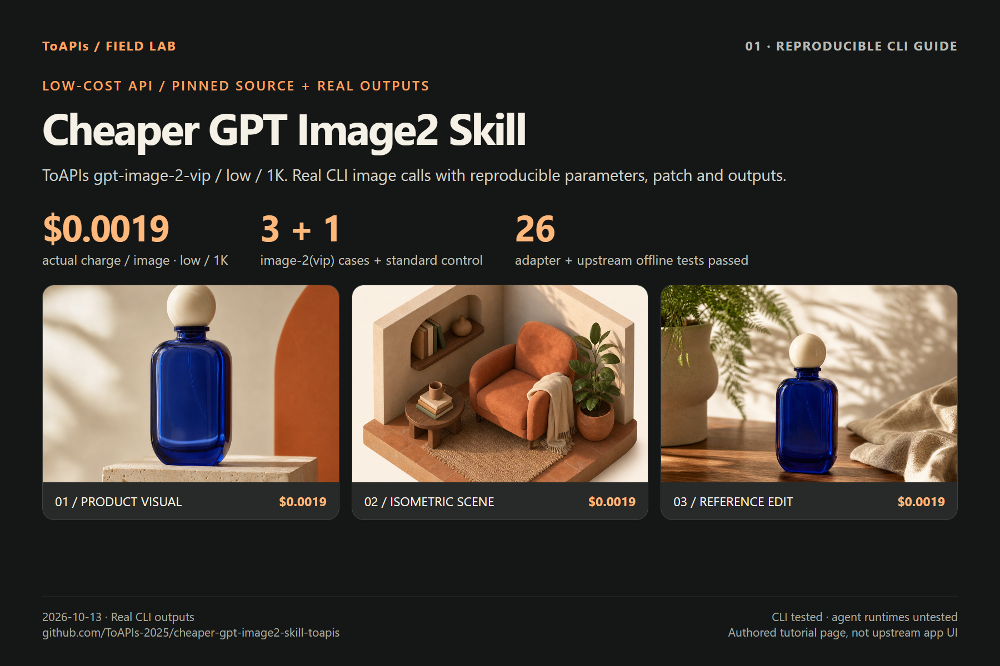
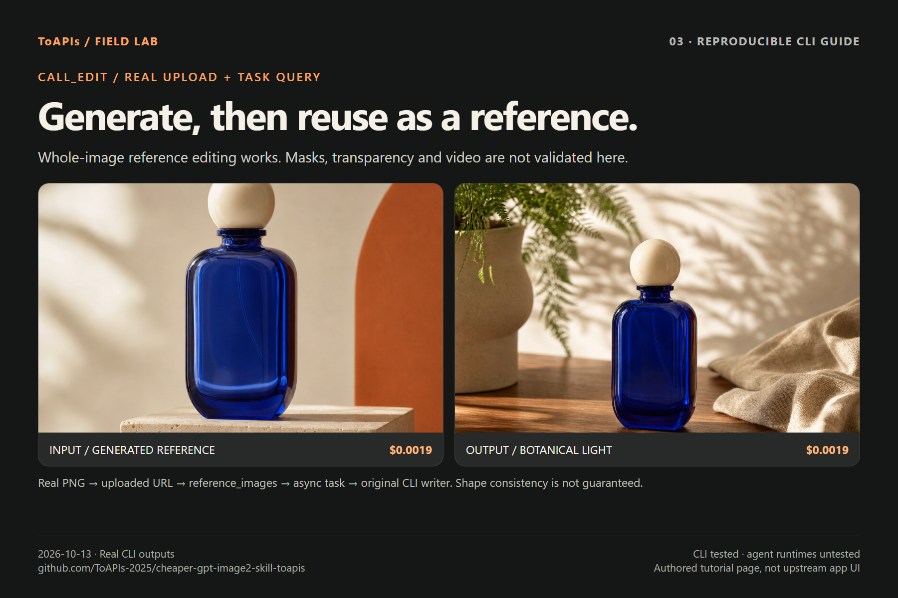

# Cheaper GPT Image2 Skill · ToAPIs image CLI

<!-- TOAPIS-MODEL-COST-UPDATE-20261016 -->
## Tested model types, presets and costs

Updated October 16, 2026. These are tested historical presets/prices; this addition does not relabel the original batch below.

| Model (API ID) | Type | Tested preset | Unit quote | Confirmed unit charge | Count |
|---|---|---|---:|---:|---:|
| gpt-image-2(VIP) (`gpt-image-2-vip`) | Image | low / 1K / n=1 | $0.0019/image | $0.0019 | 3 |
| gpt-image-2 | Image | 1K / n=1 | $0.015/image | $0.015 | 1 |

Confirmed original image/video example subtotal: **$0.0207**.

Patched CLI image generation/edit path validated; agent-host execution and video are unvalidated.

gpt-image-2(VIP), **from $0.0019/image**; the tested low/1K preset here is **$0.0019/image**. Different models, qualities and resolutions do not imply equivalent results.
<!-- /TOAPIS-MODEL-COST-UPDATE-20261016 -->

[English](README.md) · [中文](README_zh-CN.md) · [Pricing](PRICING.md) · [Charges](COSTS.md) · [Original outputs](GALLERY.md)

**$0.0019/image**: ToAPIs gpt-image-2-vip / low / 1K actual charge per VIP image, matching this test key’s catalog. A new async provider for the real wuyoscar/GPT-Image2-Skill CLI. On 2026-10-13 we completed **3 image-2(vip) generations/edits plus 1 standard control**, covering a product visual, an isometric scene and a reference edit.

## Demo





Actual total **4.14 credits=$0.0207**. The account owner confirmed 0.38 credits per VIP image and 3 credits for the standard image; 1 credit=$0.005. API billing is still absent; provenance is retained separately. [Itemized charges](COSTS.md).

## Reproduce: dry-run first, explicit live call second

Python 3.11+ and Git; tested Python3.12, openai3.29.0 and python-dotenv1.2.4. Sparse checkout retrieves CLI/tests without the full gallery. This is a community patch and guide, not an official upstream edition or proof of a partnership.

```bash
git clone https://github.com/ToAPIs-2025/cheaper-gpt-image2-skill-toapis.git
git clone --filter=blob:none --no-checkout https://github.com/wuyoscar/GPT-Image2-Skill.git gpt-image-upstream
git -C gpt-image-upstream sparse-checkout init --cone
git -C gpt-image-upstream sparse-checkout set src tests skills/gpt-image/scripts
git -C gpt-image-upstream checkout 9f8aa1a44a4a5c0f5a5d6e45eed564b3e2d5b87f
cd cheaper-gpt-image2-skill-toapis
git -C ../gpt-image-upstream apply ../cheaper-gpt-image2-skill-toapis/adapter.patch
python -m venv .venv
# Windows: .venv\Scripts\activate
# macOS/Linux: source .venv/bin/activate
python -m pip install -r requirements-demo.txt
python -m pip install -e ../gpt-image-upstream
cp .env.example .env
# Windows PowerShell: Copy-Item .env.example .env
# Configure TOAPIS_API_KEY privately; never paste it into posts.
python run_cases.py --upstream ../gpt-image-upstream
python tests/test_adapter.py --upstream ../gpt-image-upstream
python tests/run_upstream_tests.py --upstream ../gpt-image-upstream
python run_cases.py --upstream ../gpt-image-upstream --key-file .env --live --case vip-product
```

The first live command generates one image. Keep the saved outputs and private-state receipts. If no task ID is returned, reconcile Task Logs before another POST. The next command runs all four cases; completed evidence is skipped, and existing submitted tasks reuse their IDs.

```bash
python run_cases.py --upstream ../gpt-image-upstream --key-file .env --live
```

The four-case catalog estimate is $0.0207. The runner reads current rates and stops if its estimate exceeds the separate $0.10 sub-cap. Generate the first case before the reference edit; reuse any saved output with the next CLI -i input.

## Reuse the upstream CLI directly

```bash
gpt-image --provider toapis --model gpt-image-2-vip \
  --quality low --resolution 1K --size square \
  -p "A fictional cobalt-blue perfume bottle on travertine, no text or logo" \
  -f result.png --dry-run
# Remove --dry-run only when ready for a paid generation.
gpt-image --provider toapis --model gpt-image-2-vip \
  --quality low --resolution 1K --size square \
  -p "Move the reference bottle to a sunlit botanical studio, no text or logo" \
  -i result.png -f edited.png
```

The second command is a paid edit example; generate result.png and check rates first. You can also use python -m gpt_image_cli.cli or the local skill launcher. Only launcher --help was checked; no full Claude/Codex/OpenClaw agent workflow was run. A remote uvx install of the unpatched upstream does not include this ToAPIs provider.

## Protocol differences and minimal patch

Pinned upstream SHA:  `9f8aa1a44a4a5c0f5a5d6e45eed564b3e2d5b87f`.

Modify src/gpt_image_cli/cli.py and add src/gpt_image_cli/toapis.py. The default OpenAI route remains; --provider toapis selects the adapter. Original call_generate, call_edit and write_outputs execute. Async output bytes are wrapped into the CLI’s existing b64_json shape and saved unchanged.

| Contract | ToAPIs behavior |
|---|---|
| Origin/auth | https://toapis.cn or https://toapis.com; normalize optional /v1; Bearer Key |
| Model | gpt-image-2-vip + low, or gpt-image-2 without quality |
| Size | CLI 1024x1024 → size 1:1; resolution 1K; actual pixels recorded separately |
| References | POST /v1/uploads/images → reference_images:[URL] |
| Submit | POST /v1/images/generations → persist id; generation POST not retried |
| Query | GET /v1/images/generations/{id}; 8s polling, 600s limit |
| Output | result.data[0].url → credential-free download → b64_json → original writer |

This route supports n=1, opaque PNG and the two listed models. It rejects masks, input_fidelity, JPEG/WebP output, compression/user and other models. The original moderation flag has no mapped control and is omitted. Resolution is a tier, not an exact pixel guarantee. Other sizes/tiers have validation, but only 1:1/1K was tested live.

## Verification and evidence

8 adapter offline tests and 18 original-project offline tests passed. For Windows SDK3 fixtures that clear the environment, the harness creates a trusted system SSL context beforehand; it does not disable TLS verification. Four live CLI calls completed. The first wrapper run hit an output-encoding issue after generation; its task and image were retained and the original ID reused without a second generation POST. Its short recovery timing is not generation latency.

[Prompts](cases/briefs.json) · [Task IDs, requests, hashes](evidence/runs.json) · [Sanitized CLI logs](evidence/vip-reference-edit-cli.txt)

## Upstream attribution and API access

[wuyoscar/GPT-Image2-Skill](https://github.com/wuyoscar/GPT-Image2-Skill) · [Fixed source](https://github.com/wuyoscar/GPT-Image2-Skill/tree/9f8aa1a44a4a5c0f5a5d6e45eed564b3e2d5b87f) · [MIT license](LICENSE). Preserve upstream notices. All case prompts are original; no upstream gallery artwork is republished.

[Explore the ToAPIs image API and prices](https://go2v.toapis.com/1013_gptskill_cheaper_gh_en) · [X screenshot reuse](SCREENSHOT_GUIDE.md)
